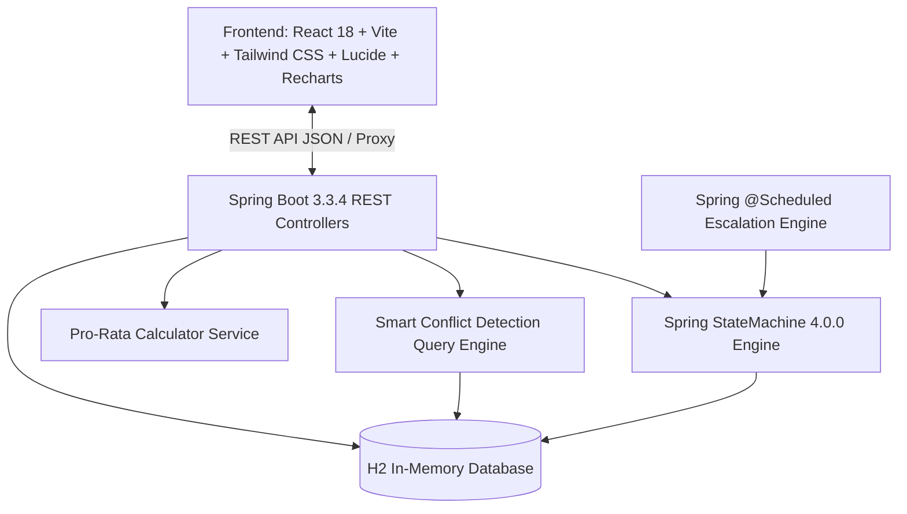

# LeaveFlow Pro — Leave Management App with Approval Chains

[](https://openjdk.org/)
[](https://spring.io/projects/spring-boot)
[](https://spring.io/projects/spring-statemachine)
[](https://react.dev/)
[](https://vitejs.dev/)
[](https://tailwindcss.com/)
[](https://opensource.org/licenses/MIT)

> **Team Fusion Hackathon Submission**: A production-grade, enterprise-ready Leave Management System featuring multi-tier approval chains, formal state machine transitions, pro-rata allowance calculations, smart non-blocking team conflict detection, and background auto-escalation.

---

## 🌟 Key Features & Mandatory Algorithms

### 1. Explicit State Machine (Spring StateMachine 4.0.0)
Transitions follow an explicit, mathematically sound finite state machine:
```
[SUBMITTED]
    │  (event: SUBMIT)
    ▼
[MANAGER_PENDING]
    ├── (event: MANAGER_APPROVE) ──► [HR_PENDING]
    ├── (event: MANAGER_REJECT)  ──► [REJECTED]
    └── (event: ESCALATE)        ──► [HR_PENDING] (Audit note attached)

[HR_PENDING]
    ├── (event: HR_APPROVE)      ──► [APPROVED] (Deducts leave days from balance)
    └── (event: HR_REJECT)       ──► [REJECTED]
```

### 2. Pro-Rata Leave Calculation
Accurately calculates remaining leave entitlement for mid-year hires:
$$\text{Pro-Rata Balance} = \left(\frac{\text{Annual Allowance}}{12}\right) \times (\text{Remaining Months in Calendar Year})$$

- **Benchmark Case**: Full annual leave is 24 days. An employee joining on **July 1** receives exactly **12.0 days** (6 remaining months).
- Interactive Pro-Rata Calculator built into the UI for instant testing of any join date!

### 3. Smart Conflict Detection (>20% Team Capacity Warning)
- When an employee applies for leave, the engine queries overlapping leaves for the same team across `MANAGER_PENDING`, `HR_PENDING`, and `APPROVED` statuses.
- If $>20\%$ of the team will be absent during the requested window:
  - The request is **NOT blocked** (preserving workflow velocity).
  - Flags `hasTeamConflict = true` and generates details: `Team Capacity Warning: 50.0% of team (2/4 members) concurrently away. Overlapping teammates: David Chen`.
  - Displays a high-visibility, animated warning badge with expandable conflict details in the Manager Review Hub.

### 4. Automatic Escalation (@Scheduled Background Engine)
- Background cron runner in `EscalationScheduler.java` runs every 60 seconds (`cron = "0 * * * * ?"`).
- Automatically identifies requests in `MANAGER_PENDING` for $>2$ minutes (simulated for demo).
- Transitions them via `LeaveEvent.ESCALATE` to `HR_PENDING` with the audit note:
  > *"Auto-escalated due to manager timeout."*
- Features an instant "Run Auto-Escalation" button in the navigation bar for instant judge demonstration.

---

## 🏗️ Architecture & Tech Stack



- **Backend**: Java 21, Spring Boot 3.3.4, Spring Data JPA, Spring Web, Spring StateMachine 4.0.0.
- **Database**: H2 In-Memory Database (`jdbc:h2:mem:leavedb`) with automatic console (`/h2-console`).
- **Frontend**: React 18, Vite, Tailwind CSS, Lucide Icons, Recharts dashboard visualizations.

---

## 👥 Seeded Users (Instantly Demo-Ready)

The database is pre-seeded with 8 personas across 2 teams via `CommandLineRunner`:

| Role | Name | Email / Team | Join Date | Balance |
| :--- | :--- | :--- | :--- | :--- |
| **HR** | Sarah Jenkins | `sarah.jenkins@company.com` • Executive HR | `2022-01-15` | 24.0 days |
| **Manager** | Alex Mercer | `alex.mercer@company.com` • Team Alpha (Engineering) | `2023-03-01` | 24.0 days |
| **Manager** | Elena Vance | `elena.vance@company.com` • Team Beta (Design) | `2023-06-01` | 24.0 days |
| **Employee** | Priya Sharma | `priya.sharma@company.com` • Team Alpha | `2026-07-01` | **12.0 days** (Pro-rated) |
| **Employee** | Marcus Brody | `marcus.brody@company.com` • Team Alpha | `2026-03-01` | **20.0 days** (Pro-rated) |
| **Employee** | David Chen | `david.chen@company.com` • Team Alpha | `2026-01-10` | **24.0 days** (Full year) |
| **Employee** | Chloe Zhao | `chloe.zhao@company.com` • Team Beta | `2026-02-15` | **21.0 days** (Pro-rated) |
| **Employee** | Liam O'Connor | `liam.oconnor@company.com` • Team Beta | `2026-08-01` | **10.0 days** (Pro-rated) |

---

## 🚀 Quickstart & Setup

### Prerequisites
- Java 21 or newer
- Apache Maven 3.8+
- Node.js 18+ and npm

### 1. Run the Backend
```bash
cd backend
mvn spring-boot:run
```
- Backend starts at: `http://localhost:8080`
- H2 Web Console: `http://localhost:8080/h2-console`
  - **JDBC URL**: `jdbc:h2:mem:leavedb`
  - **User**: `sa`
  - **Password**: *(leave blank)*

### 2. Run the Frontend
```bash
cd frontend
npm install
npm run dev
```
- Open your browser at: `http://localhost:5173`

---

## 🧪 Running Automated Tests

Run backend unit and integration tests covering the state machine, conflict detection, and pro-rata math:
```bash
cd backend
mvn test
```

---

## 📡 REST API Reference

| Method | Endpoint | Description |
| :--- | :--- | :--- |
| `GET` | `/api/auth/users` | List all seeded personas for live role switching |
| `POST` | `/api/auth/login?userId={id}` | Mock login / switch active persona |
| `POST` | `/api/leaves/apply` | Apply for leave (runs balance check & conflict query) |
| `GET` | `/api/leaves/my-requests?userId={id}` | Retrieve requests for an employee |
| `GET` | `/api/leaves/manager/pending?managerId={id}` | Pending requests for team manager |
| `GET` | `/api/leaves/hr/pending` | Final review queue for HR |
| `GET` | `/api/leaves/hr/escalated` | List all auto-escalated requests with notes |
| `POST` | `/api/leaves/approve/{id}` | Approve request (advances state in StateMachine) |
| `POST` | `/api/leaves/reject/{id}` | Reject request (transitions to `REJECTED`) |
| `POST` | `/api/leaves/escalate/{id}` | Manually escalate a specific request |
| `POST` | `/api/leaves/trigger-escalation` | Trigger the @Scheduled escalation job immediately |
| `GET` | `/api/leaves/conflict-check` | Pre-flight check for date overlap |
| `GET` | `/api/leaves/pro-rata-calculator` | Pro-rata calculation utility for judges |
| `GET` | `/api/leaves/stats` | KPI counters & status distribution data |

---

## 🏆 Hackathon Evaluation Guide

1. **Role Switcher**: Click the user profile in the top-right corner to switch between **Priya Sharma (Employee)**, **Alex Mercer (Manager)**, and **Sarah Jenkins (HR)**.
2. **Pro-Rata Verification**: View Priya Sharma's dashboard. Notice her join date (`2026-07-01`) gives exactly `12.0 / 24` days. Click **"Inspect Pro-Rata Math"** to test other dates (e.g. Oct 1 -> 6d, Jan 1 -> 24d).
3. **Smart Conflict Warning**: Switch to Manager View to see Marcus Brody's request flagged with the bright yellow badge: `Team Capacity Warning! (>20% Out)`. Click the badge to expand details.
4. **Auto-Escalation**: Switch to HR Command Center to inspect the dedicated **"Auto-Escalated Requests"** spotlight section, with the audit note `"Auto-escalated due to manager timeout."`
5. **Interactive Charts**: Observe the real-time Recharts visualizations showing status distributions and team volume breakdown.
